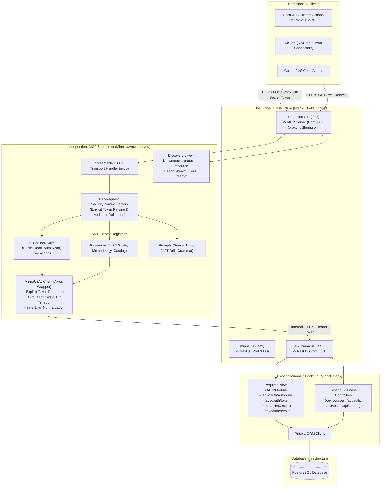
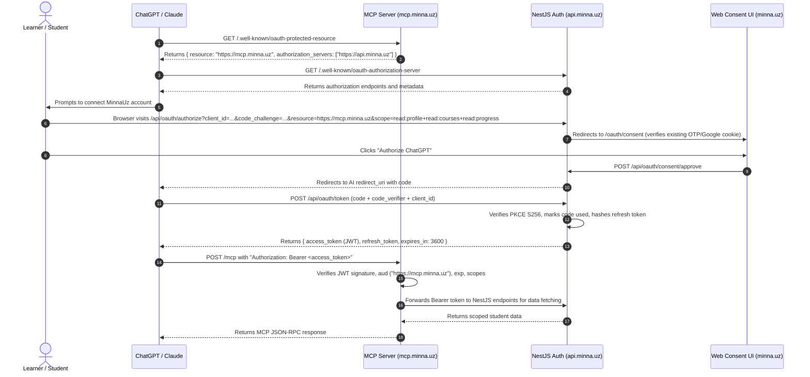

# MinnaUz Model Context Protocol (MCP) Server — Implementation Plan

**Document Version:** 3.0 (Production Architecture & Security Specification)  
**Status:** Under Final Review (Planning Only — No Implementation Started)  
**Target Subproject:** `mcp-server/` in `MinnaUz` monorepo  
**Production Domain:** `mcp.minna.uz`  
**Downstream API:** `api.minna.uz` (`http://127.0.0.1:3001/api`)  
**Frontend Application:** `minna.uz` (`http://127.0.0.1:3000`)  

---

## 1. Executive Summary & Change Log

This document defines the production architecture, security engineering, protocol design, deployment topology, and verification strategy for the **MinnaUz Model Context Protocol (MCP) Server**. The MCP server enables remote, standards-compliant AI clients (ChatGPT, Claude, Cursor, and custom multi-agent runners) to interface safely with MinnaUz's Japanese curriculum, vocabulary, exercises, and learner progress.

### Evolution of Architecture Across Iterations

| Area | Version 1.0 (Initial Draft) | Version 2.0 (First Refinement) | Version 3.0 (Production Hardening) |
| :--- | :--- | :--- | :--- |
| **MCP Discovery & OAuth** | Chat-based token pasting (`authenticate_session`). | Standard OAuth 2.1 Code Flow + PKCE. | **RFC 9728 Protected Resource Metadata** + **RFC 8414 Auth Server Metadata** + **RFC 6750/9728 `WWW-Authenticate` challenges** + **OAuth Client ID Metadata Documents (CIMD)** for zero-friction ChatGPT/Claude compatibility. |
| **Token Storage & Security** | Undefined token persistence. | Generic token storage in DB. | **Zero Raw Token Storage**. Access tokens are asymmetric stateless JWTs (RS256/ES256) with JWKS; refresh tokens and authorization codes are stored solely as **cryptographic SHA-256 hashes** with automatic Refresh Token Rotation (RTR) and reuse family revocation. |
| **Request & Tenant Isolation** | Implicit shared server state. | `AsyncLocalStorage` context. | **Explicit Context Propagation**. `SecurityContext` is explicitly passed into every tool and API client call; does not rely on ALS alone. Verified via concurrent interleaved cross-user unit tests. |
| **Tool Data Separation** | Merged public and user state in course tools. | Added basic auth check. | **Strict Public vs. Authenticated Schema Separation**. `get_courses`, `get_course_details`, `get_lesson_details` never leak user progress anonymously. Added length validation, rate limits, and caching to protect `translate_japanese_uzbek` from abuse. |
| **JLPT Accuracy** | Informal Kanji/Vocab counts presented as rules. | Level breakdown. | **Cited Official Sources (Japan Foundation & JEES)**. Outlined official Item Response Theory (IRT) scaled scoring and section minimums. Clearly labeled Kanji/Vocab counts as **pedagogical estimates**, noting official lists have been discontinued since 2010. |
| **Infrastructure Compatibility** | Generic container assumption. | Basic Nginx snippet. | **100% Aligned with MinnaUz Host Stack**. Standardized PM2 process supervision (`minnauz-mcp` on port 3002), Let's Encrypt TLS on `mcp.minna.uz`, unbuffered chunked reverse proxying, and `/health` isolation. |

---

## 2. System Architecture & Monorepo Topology

The MCP Server is implemented as an independent TypeScript application in `MinnaUz/mcp-server/`. It maintains its own dependency tree, build pipeline, and test runner, sharing the monorepo only for unified version control and CI/CD coordination.



---

## 3. OAuth 2.1 & Remote MCP Discovery Architecture

### 3.1 OAuth Protected Resource Metadata (RFC 9728)
Remote MCP clients (such as ChatGPT's remote MCP connector) initiate discovery before establishing an MCP session by issuing a `GET` request to the Protected Resource Metadata endpoint.

The MCP Server serves:
`GET https://mcp.minna.uz/.well-known/oauth-protected-resource`

**Response Payload (`application/json`):**
```json
{
  "resource": "https://mcp.minna.uz",
  "authorization_servers": [
    "https://api.minna.uz"
  ],
  "scopes_supported": [
    "read:profile",
    "read:courses",
    "read:progress",
    "read:tests"
  ],
  "bearer_methods_supported": [
    "header"
  ],
  "resource_documentation": "https://minna.uz/docs/mcp"
}
```

### 3.2 Authorization Server Metadata (RFC 8414)
The backend authorization server at `api.minna.uz` exposes:
`GET https://api.minna.uz/.well-known/oauth-authorization-server`

**Response Payload (`application/json`):**
```json
{
  "issuer": "https://api.minna.uz",
  "authorization_endpoint": "https://api.minna.uz/api/oauth/authorize",
  "token_endpoint": "https://api.minna.uz/api/oauth/token",
  "jwks_uri": "https://api.minna.uz/api/oauth/jwks.json",
  "revocation_endpoint": "https://api.minna.uz/api/oauth/revoke",
  "response_types_supported": ["code"],
  "grant_types_supported": ["authorization_code", "refresh_token"],
  "code_challenge_methods_supported": ["S256"],
  "token_endpoint_auth_methods_supported": ["none", "client_secret_post"],
  "scopes_supported": [
    "read:profile",
    "read:courses",
    "read:progress",
    "read:tests",
    "write:progress",
    "write:tests"
  ]
}
```

### 3.3 Strict `WWW-Authenticate` Challenges (RFC 6750 & RFC 9728)
When a request fails authentication or requires elevated scopes, the MCP server immediately returns `HTTP 401 Unauthorized` or `HTTP 403 Forbidden` with a RFC-compliant `WWW-Authenticate` header containing authorization server hints:

1. **Missing or Unauthenticated Token on Protected Tool:**
   ```http
   HTTP/1.1 401 Unauthorized
   WWW-Authenticate: Bearer error="unauthorized", resource="https://mcp.minna.uz", authorization_uri="https://api.minna.uz/api/oauth/authorize", scope="read:profile read:courses"
   Content-Type: application/json

   {
     "jsonrpc": "2.0",
     "error": {
       "code": -32001,
       "message": "Authentication required. Please authorize this client through MinnaUz OAuth.",
       "data": { "authorizationUri": "https://api.minna.uz/api/oauth/authorize", "resource": "https://mcp.minna.uz" }
     },
     "id": null
   }
   ```
2. **Expired or Malformed Token:**
   ```http
   HTTP/1.1 401 Unauthorized
   WWW-Authenticate: Bearer error="invalid_token", error_description="The access token expired or signature failed", resource="https://mcp.minna.uz"
   ```
3. **Insufficient Scope:**
   ```http
   HTTP/1.1 403 Forbidden
   WWW-Authenticate: Bearer error="insufficient_scope", scope="read:progress", resource="https://mcp.minna.uz"
   ```

### 3.4 OAuth Client ID Metadata Documents (CIMD)
To allow seamless connection with ChatGPT and modern AI clients without requiring hardcoded client registrations for every third-party domain:
- **CIMD Validation:** The Authorization Server accepts a `client_id` formatted as a valid HTTPS URL (e.g. `https://chatgpt.com/mcp-client-metadata.json`).
- **Dynamic Fetch & Cache:** The Authorization Server fetches the JSON metadata document over HTTPS, verifies that the `redirect_uri` in the request matches one of the declared `redirect_uris` in the document, and displays the client's verified name and logo on the consent screen.
- **Pre-registered Clients:** Supported alongside CIMD for traditional developer API keys and local development.

### 3.5 Resource Indicators & Audience Validation (RFC 8707)
To prevent cross-service token replay attacks:
1. When the AI client requests a token, it sends `resource=https://mcp.minna.uz`.
2. The Authorization Server binds the resulting access token strictly to `aud: "https://mcp.minna.uz"`.
3. The MCP Server validates that `payload.aud === "https://mcp.minna.uz"` and `payload.iss === "https://api.minna.uz"`. Tokens issued for other audiences (e.g. general web client tokens or mobile app tokens) are rejected immediately.

### 3.6 Complete ChatGPT / Claude Remote MCP OAuth Flow



---

## 4. Token Security, Cryptography & Validation

### 4.1 Zero Raw Token Storage Principle
Under no circumstance are plaintext access tokens, refresh tokens, or authorization codes saved in the database:

1. **Access Tokens (Stateless Asymmetric JWTs):**
   - Signed by the NestJS Authorization Server using an **RS256** (RSA 2048-bit) or **ES256** (ECDSA P-256) private key.
   - Public key exposed via standard JWKS at `https://api.minna.uz/api/oauth/jwks.json`.
   - Lifespan: Strictly short-lived (**1 hour / 3600 seconds**).
   - Contains: `iss`, `sub` (User UUID), `aud` (`https://mcp.minna.uz`), `scope`, `client_id`, `exp`, `iat`, `jti`.
2. **Refresh Tokens (Opaque Cryptographic Strings):**
   - Random 256-bit secure strings (`crypto.randomBytes(32).toString('hex')`).
   - Only the **SHA-256 digest** (`crypto.createHash('sha256').update(rawToken).digest('hex')`) is saved in PostgreSQL (`oauth_refresh_tokens.tokenHash`).
   - Lifespan: **30 days**.
3. **Authorization Codes:**
   - Random 160-bit strings expiring in **5 minutes**.
   - Only the **SHA-256 digest** is saved in `oauth_codes.codeHash`.

### 4.2 Refresh Token Rotation (RTR) & Reuse Detection
- **Rotation:** Every call to `POST /api/oauth/token` with `grant_type=refresh_token` generates a fresh access token and a **new refresh token**. The old refresh token is marked `revoked = true`.
- **Automatic Family Revocation:** If a previously revoked or used refresh token is submitted (indicating a compromised token replay attempt), the Authorization Server immediately revokes **all** refresh tokens belonging to that client and user session, logging a high-priority security event.

### 4.3 NestJS Token Validation Pipeline
NestJS validates OAuth access tokens via a dedicated `OAuthJwtStrategy`:
1. **Signature & Algorithm:** Validates signature against internal key pair; rejects `alg: "none"`.
2. **Expiration:** Rejects tokens where `Date.now() / 1000 >= exp`.
3. **Issuer & Audience:** Asserts `iss === "https://api.minna.uz"` and `aud === "https://mcp.minna.uz"`.
4. **User Status:** Queries `prisma.user.findUnique({ where: { id: payload.sub } })` ensuring account is active and not banned.
5. **Scope Verification:** Enforces that required route scopes (e.g. `read:progress`) are present in `payload.scope.split(' ')`.

---

## 5. Request Isolation & Context Propagation

### 5.1 Why `AsyncLocalStorage` Alone Is Not a Complete Security Guarantee
While Node.js `AsyncLocalStorage` (ALS) tracks async execution contexts, relying solely on ambient ALS carries known hazards in production:
- Certain third-party transports or uncaught Promise handlers can detach from ALS boundaries.
- Fallback default values in ALS getters can mask missing contexts and cause silent authorization bypasses.
- Concurrent requests handled across microtasks could accidentally bleed state if any handler mutates a shared reference.

### 5.2 Explicit Typed `SecurityContext` Architecture
To guarantee absolute tenant isolation, the MCP Server implements **explicit parameter passing** of a dedicated `SecurityContext` alongside ALS:

```typescript
// mcp-server/src/types/security.ts
export interface AuthenticatedUserClaims {
  userId: string;
  email: string;
  role: string;
  isPro: boolean;
  clientId: string;
}

export class SecurityContext {
  public readonly requestId: string;
  public readonly isAuthenticated: boolean;
  public readonly user?: AuthenticatedUserClaims;
  public readonly rawBearerToken?: string;
  public readonly scopes: ReadonlySet<string>;

  constructor(options: {
    requestId: string;
    rawBearerToken?: string;
    user?: AuthenticatedUserClaims;
    scopes?: string[];
  }) {
    this.requestId = options.requestId;
    this.rawBearerToken = options.rawBearerToken;
    this.user = options.user;
    this.isAuthenticated = Boolean(options.user && options.rawBearerToken);
    this.scopes = new Set(options.scopes ?? []);
  }

  public assertAuthenticated(toolName: string): asserts this is { user: AuthenticatedUserClaims; rawBearerToken: string } {
    if (!this.isAuthenticated || !this.user || !this.rawBearerToken) {
      throw new McpSecurityError(
        `Tool '${toolName}' requires user authentication. Connect your MinnaUz account.`,
        -32001,
        { tool: toolName, error: 'unauthorized' }
      );
    }
  }

  public assertScope(requiredScope: string, toolName: string): void {
    this.assertAuthenticated(toolName);
    if (!this.scopes.has(requiredScope)) {
      throw new McpSecurityError(
        `Tool '${toolName}' requires scope '${requiredScope}'.`,
        -32003,
        { tool: toolName, error: 'insufficient_scope', requiredScope }
      );
    }
  }
}
```

### 5.3 Enforced Pipeline Rules
1. **Direct Parameter Injection:** Every tool registration function receives `(input: T, context: SecurityContext)`. Tools **must** read user ID and token exclusively from `context`.
2. **Explicit API Client Forwarding:** When calling `MinnaUzApiClient`, the method signature mandates passing the token explicitly:
   ```typescript
   // Correct pattern:
   await this.apiClient.getStudentStats(context.rawBearerToken);
   
   // Banned pattern:
   // await this.apiClient.getStudentStats(); // Compile error
   ```
3. **Automated Cross-User Isolation Test Suite (`tests/isolation.test.ts`):**
   - Simulates 50 concurrent interleaved requests across 3 simulated users (User A, User B, Anonymous) within a single event loop.
   - Asserts that zero responses for User A contain User B's profile ID or progress.
   - Asserts that anonymous requests never receive private cached payloads from prior authenticated runs.

---

## 6. Tool Authorization, Permissions & Cost Protection

### 6.1 Strict Separation of Public Content from Personalized Learning Progress

| Tool Name | Public Mode (Anonymous / Unauthenticated) | Authenticated Mode (Valid Bearer Token) |
| :--- | :--- | :--- |
| `get_courses` | Returns published courses: `id`, `title`, `slug`, `level`, `description`, `modulesCount`, `lessonsCount`. **Contains NO completion percentages or user status.** | Includes all course catalog metadata PLUS user-specific `progressPercentage`, `completedLessonsCount`, and enrollment status. |
| `get_course_details` | Returns syllabus and module outlines. Free lessons marked `isFree: true`. Pro lessons marked `isFree: false`. **Contains NO user lesson checkmarks.** | Unlocks full syllabus and provides per-lesson `isCompleted: boolean` and `completedSections: string[]` for the active student. |
| `get_lesson_details` | If lesson is free (`isFree: true`), returns content. If lesson is Pro (`isFree: false`), returns `{ isLocked: true, requiredTier: 'PRO' }` **without leaking vocabulary, grammar exercises, or quiz questions.** | If user has active Pro subscription, returns full 5-tab content (Kotoba, Bunpou, Kanji, Renshuu, Kaiwa) plus student's past quiz score. |

### 6.2 Rate Limits & Cost Protection for `translate_japanese_uzbek`
The backend translation endpoint (`POST /api/ai/translate`) executes LLM inference via Groq (Llama 3.3 70B), creating compute costs. To protect against denial-of-wallet and automated scraping:
1. **Strict Input Bounds:** Zod schema restricts `text` length to a maximum of **500 characters** per invocation. Requests exceeding 500 characters fail fast at the schema validation layer.
2. **Sliding-Window Rate Limiting:**
   - Anonymous clients: Maximum **5 translation calls per minute** per IP.
   - Authenticated clients: Maximum **15 translation calls per minute** per user ID.
3. **In-Memory LRU Deduplication Cache:** Identical text queries within a 1-hour window are served directly from an LRU memory cache (maximum 2,000 entries), bypassing repeated backend LLM inference.

### 6.3 5-Tier Safety Matrix

```text
┌────────────────────────────────────────────────────────────────────────┐
│                        MCP TOOL SAFETY MATRIX                          │
├────────────────────────────────┬───────────────────────────────────────┤
│ Tier 1: Public Read-Only       │ get_courses, get_course_details,       │
│                                │ get_lesson_details, get_available_    │
│                                │ tests, get_test_details, search_      │
│                                │ learning_materials, translate_ja_uz   │
├────────────────────────────────┼───────────────────────────────────────┤
│ Tier 2: Authenticated Read     │ get_my_profile, get_my_subscription,  │
│                                │ get_my_learning_statistics, get_my_   │
│                                │ study_plan, get_my_vocabulary,        │
│                                │ get_my_kanji, get_my_test_history,    │
│                                │ get_my_test_results                   │
├────────────────────────────────┼───────────────────────────────────────┤
│ Tier 3: User State Actions     │ update_lesson_progress, manage_vocab_ │
│         (Deferred to Post-MVP) │ flashcard, manage_kanji_flashcard,    │
│                                │ submit_test_answers, save_study_plan  │
├────────────────────────────────┼───────────────────────────────────────┤
│ Tier 4: Sensitive Actions      │ Device revocation, store checkout,    │
│         (EXCLUDED from MCP)    │ payment simulation, password reset    │
├────────────────────────────────┼───────────────────────────────────────┤
│ Tier 5: Administrative Actions │ User bans, course editing, teacher CMS│
│         (STRICTLY PROHIBITED)  │ notification broadcasts, banner CRUD  │
└────────────────────────────────┴───────────────────────────────────────┘
```

---

## 7. Factually Accurate JLPT & Learning Resources

### 7.1 Official JLPT Scoring & Exam Structure
All JLPT resources in the MCP server strictly cite official authorities: **The Japan Foundation (国際交流基金)** and **Japan Educational Exchanges and Services (JEES / 日本国際教育支援協会)**.

#### Official Scoring Mechanics: Item Response Theory (IRT)
- JLPT does **not** calculate test scores by summing raw question points.
- Official scores are **Scaled Scores (得点等化)** computed using Item Response Theory (IRT), ensuring that a score of 100 on one test date represents the exact same level of proficiency as a score of 100 on any other test date, regardless of variations in question difficulty.

#### Official Section & Pass Mark Breakdown

| Level | Exam Sections & Scaled Scoring | Sectional Minimum Pass Mark | Overall Pass Threshold |
| :--- | :--- | :--- | :--- |
| **N1** | 1. Language Knowledge (Vocab/Grammar): 0–60 pts<br>2. Reading: 0–60 pts<br>3. Listening: 0–60 pts | **19 / 60 pts** per section | **100 / 180 pts** |
| **N2** | 1. Language Knowledge (Vocab/Grammar): 0–60 pts<br>2. Reading: 0–60 pts<br>3. Listening: 0–60 pts | **19 / 60 pts** per section | **90 / 180 pts** |
| **N3** | 1. Language Knowledge (Vocab/Grammar): 0–60 pts<br>2. Reading: 0–60 pts<br>3. Listening: 0–60 pts | **19 / 60 pts** per section | **95 / 180 pts** |
| **N4** | 1. Language Knowledge & Reading: 0–120 pts<br>2. Listening: 0–60 pts | **38 / 120 pts** (Vocab/Reading)<br>**19 / 60 pts** (Listening) | **90 / 180 pts** |
| **N5** | 1. Language Knowledge & Reading: 0–120 pts<br>2. Listening: 0–60 pts | **38 / 120 pts** (Vocab/Reading)<br>**19 / 60 pts** (Listening) | **80 / 180 pts** |

> [!IMPORTANT]
> **Sectional Minimum Rule:** To pass the JLPT, a test-taker must meet **both** the Overall Pass Threshold **and** the Sectional Minimum for every individual section. Failing even one section disqualifies the candidate, regardless of the aggregate total.

#### Explicit Clarification on Kanji and Vocabulary Requirements
- **Official Policy:** Since the major 2010 revision, the Japan Foundation and JEES **officially discontinued the publication of kanji and vocabulary specifications**. The exam evaluates communicative competency rather than memorization of a closed syllabus.
- **Pedagogical Estimates:** In all MCP prompts and resources, kanji and vocabulary figures are explicitly labeled as **"Pedagogical Estimates"** based on standard Japanese educational texts (*Minna no Nihongo*, *Shin Kanzen Master*):
  - **N5:** ~100 Kanji, ~800 words (Pedagogical estimate)
  - **N4:** ~300 Kanji, ~1,500 words (Pedagogical estimate)
  - **N3:** ~650 Kanji, ~3,750 words (Pedagogical estimate)
  - **N2:** ~1,000 Kanji, ~6,000 words (Pedagogical estimate)
  - **N1:** ~2,000 Kanji, ~10,000 words (Pedagogical estimate)

### 7.2 Linguistic Methodology for Uzbek Native Speakers
MinnaUz's pedagogical approach takes advantage of natural linguistic affinities between the Uzbek and Japanese languages:
1. **Shared Syntactic Architecture (SOV):** Both Japanese and Uzbek follow strict **Subject-Object-Verb (SOV)** word order, eliminating the syntactic inversion challenges faced by native English speakers.
2. **Agglutinative Postpositional Systems:**
   - Uzbek dative `-ga` corresponds naturally to Japanese direction/indirect object particles `に` (ni) and `へ` (e).
   - Uzbek locative `-da` corresponds to location of action `で` (de) and static existence `に` (ni).
   - Uzbek ablative `-dan` corresponds to source particle `から` (kara).
   - Uzbek accusative `-ni` corresponds to direct object marker `を` (o).
   - Uzbek topic marker *-chi* / *esa* corresponds to topic particle `は` (wa).
3. **Phonetic Clarity:** Both languages share pure, stable 5-vowel phonemes (/a/, /i/, /u/, /e/, /o/) without English vowel dipthongization or unpredictable stress shifts.

---

## 8. Deployment Compatibility with Existing MinnaUz Architecture

### 8.1 Process Supervision (PM2)
The existing MinnaUz host runs backend and frontend services under PM2. The MCP server integrates directly into this topology:

```bash
# Production ecosystem configuration (pm2.config.js)
module.exports = {
  apps: [
    {
      name: 'minnauz-api',
      cwd: '/var/www/minnauz/api',
      script: 'dist/main.js',
      env: { PORT: 3001, NODE_ENV: 'production' }
    },
    {
      name: 'minnauz-web',
      cwd: '/var/www/minnauz/web',
      script: 'npm',
      args: 'start',
      env: { PORT: 3000, NODE_ENV: 'production' }
    },
    {
      name: 'minnauz-mcp',
      cwd: '/var/www/minnauz/mcp-server',
      script: 'dist/index.js',
      instances: 2,
      exec_mode: 'cluster',
      kill_timeout: 10000,
      env: {
        PORT: 3002,
        NODE_ENV: 'production',
        MINNAUZ_API_URL: 'http://127.0.0.1:3001/api'
      }
    }
  ]
};
```

### 8.2 Host Nginx Reverse Proxy & TLS Configuration (`mcp.minna.uz`)
The reverse proxy terminates TLS using Let's Encrypt and forwards chunked HTTP traffic without proxy buffering:

```nginx
# /etc/nginx/sites-available/mcp.minna.uz
server {
    listen 80;
    server_name mcp.minna.uz;
    return 301 https://$host$request_uri;
}

server {
    listen 443 ssl http2;
    server_name mcp.minna.uz;

    ssl_certificate /etc/letsencrypt/live/mcp.minna.uz/fullchain.pem;
    ssl_certificate_key /etc/letsencrypt/live/mcp.minna.uz/privkey.pem;

    ssl_protocols TLSv1.2 TLSv1.3;
    ssl_ciphers HIGH:!aNULL:!MD5;
    ssl_prefer_server_ciphers on;

    # Buffering MUST be disabled for Streamable HTTP chunked streaming
    proxy_buffering off;
    proxy_cache off;
    chunked_transfer_encoding on;

    # Timeouts for interactive LLM tool execution
    proxy_read_timeout 300s;
    proxy_send_timeout 300s;
    proxy_connect_timeout 10s;

    # Core MCP transport
    location /mcp {
        proxy_pass http://127.0.0.1:3002/mcp;
        proxy_http_version 1.1;
        proxy_set_header Host $host;
        proxy_set_header X-Real-IP $remote_addr;
        proxy_set_header X-Forwarded-For $proxy_add_x_forwarded_for;
        proxy_set_header X-Forwarded-Proto $scheme;
    }

    # RFC 9728 Discovery endpoint
    location /.well-known/oauth-protected-resource {
        proxy_pass http://127.0.0.1:3002/.well-known/oauth-protected-resource;
        proxy_http_version 1.1;
        proxy_set_header Host $host;
    }

    # Shallow health check for uptime monitors
    location /health {
        proxy_pass http://127.0.0.1:3002/health;
        access_log off;
    }

    # Deep readiness probe
    location /readyz {
        proxy_pass http://127.0.0.1:3002/readyz;
        access_log off;
    }
}
```

### 8.3 Health Monitoring & Graceful Termination
1. **Health Routes:**
   - `/health`: Instant 200 OK returning process memory and uptime.
   - `/livez`: Liveness check verifying the HTTP event loop is responsive.
   - `/readyz`: Readiness check that executes an internal HTTP ping to `api.minna.uz/api` to verify backend reachability.
2. **Graceful Shutdown Protocol:**
   - Handles `SIGTERM` and `SIGINT`.
   - Stops accepting new `/mcp` HTTP connections.
   - Grants in-flight MCP tool executions up to **10 seconds** to complete cleanly before terminating process.
3. **Structured Log Sanitization:**
   - Application logger intercepts all outgoing log entries.
   - Automatically redacts `Authorization`, `x-minnauz-token`, email addresses, and JWT strings matching regex pattern `ey[A-Za-z0-9_-]+\.[A-Za-z0-9_-]+\.[A-Za-z0-9_-]+`.

---

## 9. Phased Execution Roadmap

### Phase 1: Architecture Review & Alignment (Current Phase)
- [x] Complete security audit of existing NestJS backend.
- [x] Specify RFC 9728, RFC 8414, CIMD, and PKCE OAuth 2.1 protocol architecture.
- [x] Define explicit `SecurityContext` propagation and zero-raw-token database storage.
- [x] Differentiate public vs authenticated schemas across all course tools.
- [x] Align deployment manifests with existing PM2 and Nginx infrastructure.
- [ ] Receive formal human sign-off on open design decisions.

### Phase 2: Backend OAuth 2.1 Prerequisite Implementation (`api/` & `web/`)
- [ ] Add Prisma models: `OAuthClient`, `OAuthCode`, `OAuthRefreshToken` with SHA-256 hashed fields.
- [ ] Generate database migration: `npx prisma migrate dev --name add_oauth_tables`.
- [ ] Implement `OAuthModule` in NestJS with `/api/oauth/authorize`, `/api/oauth/token`, `/api/oauth/jwks.json`, and `/api/oauth/revoke`.
- [ ] Implement consent page in Next.js (`web/app/[locale]/oauth/consent/page.tsx`).
- [ ] Add backend endpoint `GET /api/courses/grammar/all` and include `bunpou_items` in `SearchService`.

### Phase 3: Independent `mcp-server` Scaffolding
- [ ] Create `MinnaUz/mcp-server/package.json` with `@modelcontextprotocol/sdk`, `express`, `zod`, `axios`.
- [ ] Configure `tsconfig.json` (strict ESM).
- [ ] Configure `vitest.config.ts`.
- [ ] Implement `src/config/env.ts` with strict Zod schema.
- [ ] Implement `src/services/api-client.ts` with explicit token parameters and 10s timeouts.

### Phase 4: Transport, Security Layer & Discovery
- [ ] Implement Streamable HTTP transport handler on `POST /mcp`.
- [ ] Implement RFC 9728 endpoint `GET /.well-known/oauth-protected-resource`.
- [ ] Implement `/health`, `/livez`, `/readyz`.
- [ ] Implement explicit `SecurityContext` pipeline and `WWW-Authenticate` challenge responses.
- [ ] Implement optional local developer STDIO runner (`src/transport/stdio.ts`).

### Phase 5: Tool, Resource & Prompt Suite Implementation
- [ ] Implement Tier 1 Public Tools (`get_courses`, `get_course_details`, `get_lesson_details`, `search_learning_materials`, `translate_japanese_uzbek`, `get_available_tests`, `get_test_details`).
- [ ] Implement Tier 2 Authenticated Read Tools (`get_my_profile`, `get_my_subscription`, `get_my_learning_statistics`, `get_my_study_plan`, `get_my_vocabulary`, `get_my_kanji`, `get_my_test_history`, `get_my_test_results`).
- [ ] Implement 4 Resources (`platform/info`, `jlpt/guide`, `methodology/uzbek-japanese`, `courses/catalog`).
- [ ] Implement 3 Prompts (`japanese_sensei`, `jlpt_exam_tutor`, `grammar_breakdown`).

### Phase 6: Automated Verification & Regression Testing
- [ ] Parameter validation tests with Zod.
- [ ] Cross-user concurrency isolation tests (`tests/isolation.test.ts`).
- [ ] Mocked backend failure tests (401, 403, 404, 500, timeout).
- [ ] Monorepo verification: `npm --prefix api test` and `npm --prefix web build`.

### Phase 7: Host Deployment & Documentation
- [ ] Create `mcp-server/README.md` with Claude Desktop and ChatGPT setup instructions.
- [ ] Update root `README.md`.
- [ ] Provision PM2 process `minnauz-mcp` and Nginx host block for `mcp.minna.uz`.

---

## 10. List of Remaining Decisions Requiring Human Approval

The following decisions require confirmation before implementation work begins:

1. **OAuth Implementation Strategy & Phasing:**
   - **Recommendation:** Implement Phase 2 (`OAuthModule` in NestJS + consent page in Next.js) before public launch of the MCP server, providing compliance with ChatGPT's remote MCP specification and RFC 9728.
   - **Alternative (Developer Early Access):** For immediate internal testing, build the MCP server using local STDIO mode with a static developer token in `.env`, deferring the public HTTP server and OAuth until backend approval is finalized.
2. **Grammar Search Backend Endpoint:**
   - **Decision:** Approval to add `GET /api/courses/grammar/all` and include `bunpou_items` in `SearchService.globalSearch` within `api/src/courses/` and `api/src/search/` so the MCP server can offer standalone grammar lookups.
3. **Subdomain & DNS Delegation:**
   - **Decision:** Confirming `mcp.minna.uz` as the designated production domain and authorizing DNS record creation pointing to the host IP.
4. **Third-Party AI Client Metadata Policy (CIMD):**
   - **Decision:** Choosing whether to enable automatic approval for standard AI client metadata documents (ChatGPT, Claude) via CIMD, or restricting access to pre-registered OAuth clients managed manually by MinnaUz administrators.
